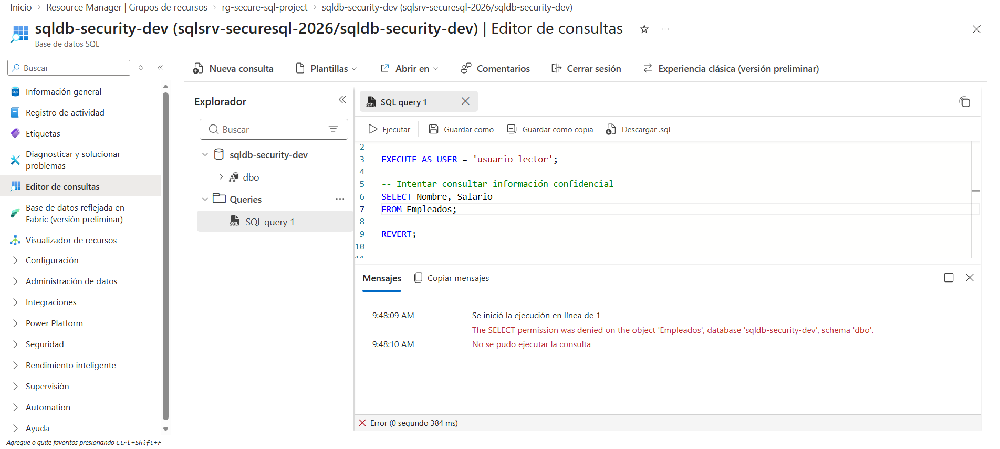
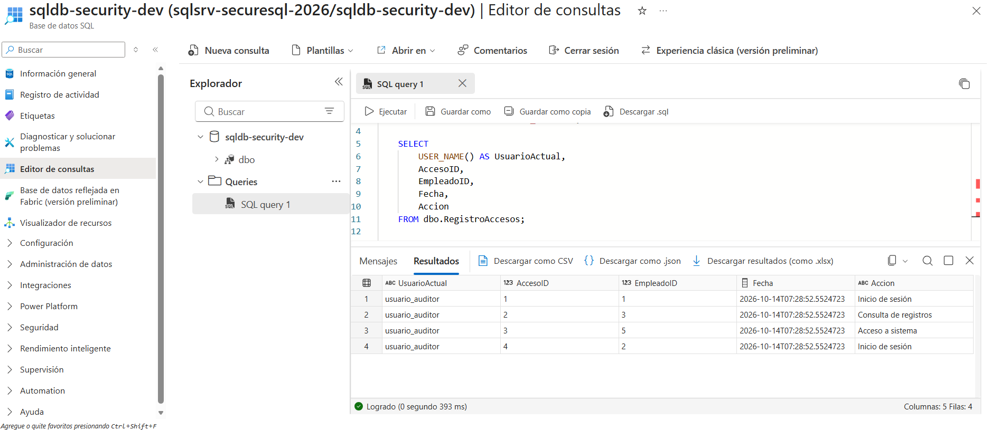
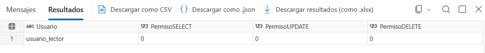
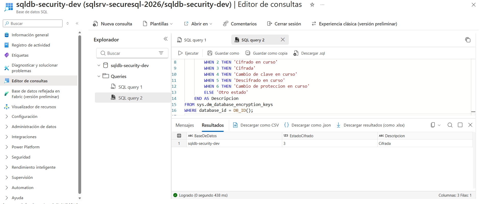
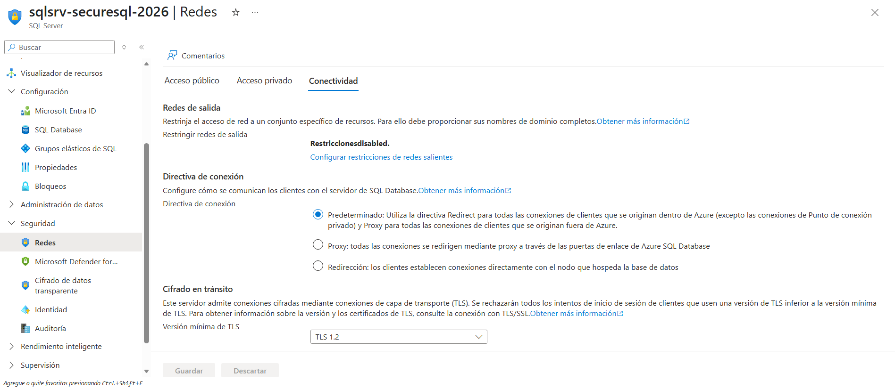

# 2. Pruebas de seguridad y control de acceso

## 2.1. Objetivo

El objetivo de estas pruebas es verificar que los mecanismos de autorización implementados en Azure SQL Database funcionan correctamente y aplican el principio de mínimo privilegio.

Para ello, se han creado tres roles SQL: `rol_lector`, `rol_auditor` y `rol_recursos_humanos`, cada uno con permisos específicos.

Se han utilizado usuarios de prueba sin inicio de sesión, junto con `EXECUTE AS USER`, para simular diferentes contextos de autorización dentro de la base de datos.

## 2.2. Acceso denegado al lector

Se simuló una consulta realizada por `usuario_lector` sobre la tabla `Empleados`, intentando acceder a información salarial.

**Resultado:** Azure SQL rechazó la consulta por falta del permiso `SELECT` sobre la tabla.

## 2.3. Acceso autorizado del auditor

Se comprobó que `usuario_auditor` podía consultar los registros ficticios almacenados en `RegistroAccesos`.

**Resultado:** la consulta devolvió correctamente cuatro registros.

## 2.4. Acceso denegado al auditor

Se intentó consultar información salarial desde el contexto del usuario auditor.

**Resultado:** Azure SQL bloqueó la consulta por falta de permisos sobre `Empleados`.

## 2.5. Verificación de permisos del lector

Se utilizó la función `HAS_PERMS_BY_NAME()` para comprobar los permisos efectivos del usuario lector sobre la tabla `Empleados`.

**Resultado:** los permisos `SELECT`, `UPDATE` y `DELETE` devolvieron el valor `0`.

## 2.6. Verificación del cifrado TDE

Se consultó el estado de Transparent Data Encryption mediante `sys.dm_database_encryption_keys`.

**Resultado:** la base de datos devolvió `encryption_state = 3`, confirmando que el cifrado en reposo estaba activo.

## 2.7. Configuración de TLS

Se revisó la configuración de conectividad del servidor lógico Azure SQL.

**Resultado:** se verificó que la versión mínima aceptada era TLS 1.2.

## 2.8. Conclusiones

Las pruebas realizadas confirman que los controles de autorización SQL restringen el acceso a los datos según los permisos concedidos.

También se verificó el cifrado TDE y la configuración mínima de TLS, proporcionando mecanismos de protección complementarios para los datos almacenados y las comunicaciones.

Estas pruebas corresponden a un entorno de desarrollo con datos ficticios y usuarios simulados, no a una auditoría completa de seguridad de producción.
